# EIUS Lab

**邊緣智能與無人系統實驗室**  
Edge Intelligence & Unmanned Systems Lab · 龍華科技大學 資訊工程系

---

## 關於我們

EIUS Lab 專注於 **無人機系統、無線網路通訊與人工智慧** 的交叉研究。我們讓無人機不只是會飛的載具，而是能彼此連線、即時傳遞資料，並由 AI 協助感知與決策的空中智慧節點。

研究從問題定義、演算法設計、模擬驗證一路延伸到實機測試，期望把理論成果落實到真實場域。

- **指導教授：** Tsai, Hua-Wen
- **成立時間：** 2020
- **實驗室位置：** F717

## 實驗室特色

| 特色 | 說明 |
| --- | --- |
| 跨領域整合 | 將飛行控制、通訊網路與 AI 模型放在同一個系統中思考，而非各自獨立研究 |
| 從模擬到實機 | 先以模擬環境快速驗證想法，再進入實機飛行與場域測試 |
| 軟硬體兼具 | 同時累積嵌入式、韌體、網路協定與機器學習的實作能力 |

## 研究方向

### 1. 人工智慧驅動的感知與決策

- **研究問題：** 如何讓 AI 在算力與能源有限的無人機上，即時理解環境並做出決策
- **技術與方法：** 影像辨識、輕量化模型、AI Agent

## 加入我們

歡迎對無人機、網路通訊或人工智慧有興趣的同學加入。不需要三個領域都熟悉，只要願意動手實作、從問題出發思考，我們都很樂意一起討論。

- **招生對象：**碩士班 / 專題生
- **聯絡方式：[eiuslab717@gmail.com](mailto:eiuslab717@gmail.com)**
