# EIUS Lab

**Edge Intelligence & Unmanned Systems Lab**  
Department of Computer Science and Information Engineering · Lunghwa University of Science and Technology

##  About Us

EIUS Lab focuses on interdisciplinary research across **drone systems, wireless communication, and artificial intelligence**. We see drones not just as flying vehicles, but as intelligent aerial nodes that connect with each other, exchange data in real time, and rely on AI for perception and decision-making.

Our research spans problem definition, algorithm design, and simulation, all the way to real-world flight testing, with the goal of turning theory into results that work in the field.

##  What Makes Us Different

##  Research Areas

##  Join Us

**Contact:** [eiuslab717@gmail.com](mailto:eiuslab717@gmail.com)

